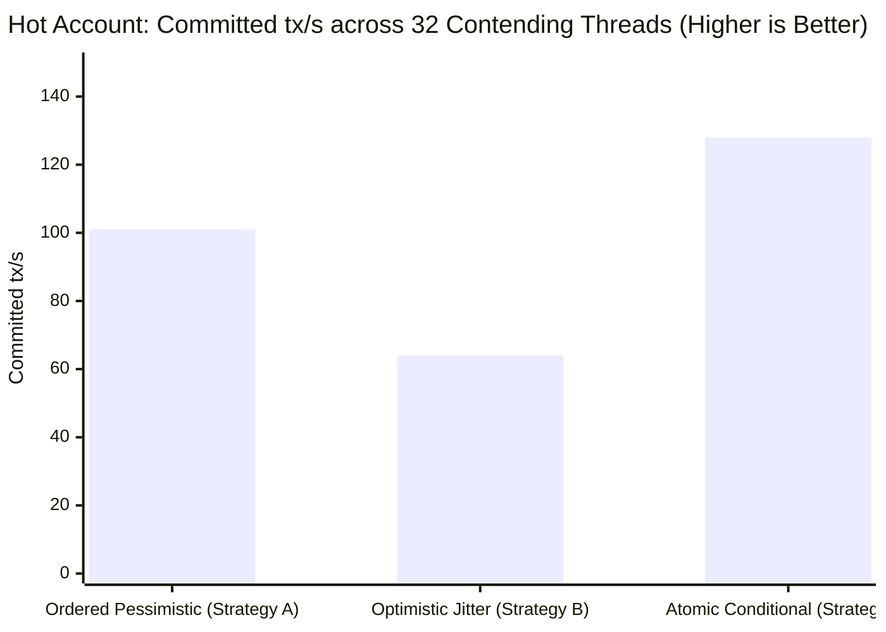
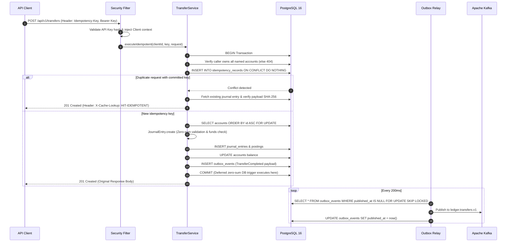

# Ledger Line

[](https://openjdk.org/projects/jdk/21/)
[](https://spring.io/projects/spring-boot)
[](https://www.postgresql.org/)
[-black.svg?logo=apachekafka&logoColor=white)](https://kafka.apache.org/)
[](https://docs.docker.com/compose/)
[](LICENSE)

> A production-grade double-entry financial ledger service in **Java 21**, **Spring Boot 3**, and **PostgreSQL 16**. Demonstrates, through empirical benchmarks and automated chaos tests, how to maintain financial invariants, idempotency, and auditability under high concurrency, network partitions, and infrastructure crashes.

---

## Quickstart: Run Everything in One Command

Run the complete multi-container stack—**PostgreSQL 16**, **Apache Kafka (KRaft)**, **Ledger Line**, and an automated curl smoke test walkthrough:

```bash
docker compose up --build
```

The `demo` service runs [`scripts/demo.sh`](scripts/demo.sh) against the live container, verifies each architectural guarantee over HTTP, and prints `PASS`/`FAIL` for every step.

To run locally on host:
```bash
# 1. Start backing PostgreSQL and Kafka
docker compose up -d postgres kafka

# 2. Run test suite (all integration tests run against Testcontainers)
./gradlew check

# 3. Boot application
./gradlew bootRun
```

---

## Core Guarantees & Financial Invariants

Ledger Line models a strict double-entry ledger where money can neither be created nor destroyed out of thin air:

| Guarantee | Mechanism | Verification Test |
|---|---|---|
| **Mathematical Zero-Sum** | $\sum \text{Debits} = \sum \text{Credits}$ enforced in domain model and by a PostgreSQL deferred constraint trigger (`DEFERRABLE INITIALLY DEFERRED`). | [`ZeroSumBalanceInvariantIntegrationTest`](src/test/java/com/ledgerline/integration/ZeroSumBalanceInvariantIntegrationTest.java) |
| **Append-Only Immutability** | Database triggers prevent direct `UPDATE` or `DELETE` on `journal_entries` and `postings`. Corrections require balanced offsetting entries. | [`ZeroSumBalanceInvariantIntegrationTest`](src/test/java/com/ledgerline/integration/ZeroSumBalanceInvariantIntegrationTest.java) |
| **Strict Idempotency** | Mandatory `Idempotency-Key` header with SHA-256 payload fingerprinting. Concurrent duplicates block and replay original cached response (`X-Cache-Lookup: HIT-IDEMPOTENT`). Body mutations return `422 Unprocessable Entity`. | [`IdempotencyDuplicateHammerTest`](src/test/java/com/ledgerline/integration/IdempotencyDuplicateHammerTest.java), [`TransferApiIdempotencyTest`](src/test/java/com/ledgerline/integration/TransferApiIdempotencyTest.java) |
| **Concurrency & Zero Deadlocks** | Three pluggable locking models evaluated. Ascending UUID canonical lock ordering eliminates PostgreSQL `40P01` deadlocks completely under high load. | [`ConcurrentTransferStressTest`](src/test/java/com/ledgerline/integration/ConcurrentTransferStressTest.java), [`BidirectionalDeadlockTest`](src/test/java/com/ledgerline/integration/BidirectionalDeadlockTest.java) |
| **Transactional Outbox to Kafka** | Domain events (`TransferCompleted`, `LedgerDriftDetected`) commit atomically in the same database transaction as postings. Background relay publishes at-least-once with consumer deduplication. | [`OutboxAtomicityTest`](src/test/java/com/ledgerline/integration/OutboxAtomicityTest.java), [`TransactionalOutboxResilienceTest`](src/test/java/com/ledgerline/integration/TransactionalOutboxResilienceTest.java) |
| **Continuous Self-Audit & Drift Freeze** | Scheduled reconciliation scanner computes running balances from postings against cached account balances. Drifted accounts freeze automatically (`423 Locked`) and alert on-call. | [`ChaosDriftDetectionTest`](src/test/java/com/ledgerline/integration/ChaosDriftDetectionTest.java), [`AccountAdminApiTest`](src/test/java/com/ledgerline/integration/AccountAdminApiTest.java) |
| **Multi-Currency (FX)** | Multi-leg entries zero-sum per currency. Cross-currency settlements route exclusively through dedicated internal `FX_CLEARING` accounts with banker's rounding (`HALF_EVEN`). | [`FxTransferApiTest`](src/test/java/com/ledgerline/integration/FxTransferApiTest.java), [`FxMathTest`](src/test/java/com/ledgerline/application/service/FxMathTest.java) |
| **Stateless API-Key Security** | Constant-time SHA-256 key hashing (plaintext never stored), role-based endpoint segregation (`ROLE_CLIENT`, `ROLE_ADMIN`), and tenant-isolated account access. | [`SecurityApiTest`](src/test/java/com/ledgerline/integration/SecurityApiTest.java) |

---

## Measured, Not Assumed

All architectural claims are verified through empirical data and automated benchmarks:

### 1. HTTP Steady State (k6 Open Model)
Tested with [perf/k6/steady-state.js](perf/k6/steady-state.js) running open-model constant arrival rate at **200 req/s** for 60 seconds with 5% concurrent retries:
* **p50 Latency**: `14.2 ms`
* **p95 Latency**: `19.8 ms`
* **p99 Latency**: `25.3 ms` (Target SLA: `< 50 ms`)
* **Failures**: `0` (100% success rate across 12,001 steady-state requests)
* **Replays**: `100%` idempotent match with exact payload fidelity
* See [k6 benchmark report](docs/benchmarks/k6-steady-state.md) for full run analysis and Prometheus metric snapshots.

### 2. Concurrency Strategy Shootout (ADR-002)
Benchmarked under 32 concurrent worker threads contending on a single hot account vs low contention:

| Concurrency Model | Hot Account Throughput | Hot Account Rejection % | Hot Account p99 Latency | Low Contention Throughput | Tradeoff Verdict |
|---|---|---|---|---|---|
| **Strategy A: Ordered Pessimistic** (`SELECT ... FOR UPDATE`) | **101 tx/s** | **0.0%** | **718 ms** | 1,160 tx/s | **Default Selection**: Predictable tail latency, zero rejected requests, balance invariants stay unified in domain service. |
| **Strategy B: Optimistic Locking** (`@Version` + Full Jitter) | 64 tx/s | 63.0% | 445 ms | 806 tx/s | **Rejected for Hot Accounts**: Under single-row contention, retries collapse and 60%+ transfers fail with lock exhaustion. |
| **Strategy C: Atomic Conditional** (`UPDATE accounts SET balance = balance + :delta`) | 128 tx/s | 0.0% | 3,130 ms | 1,284 tx/s | **Alternative Upgrade Path**: High throughput, but unfair locking creates extreme tail latency (p99 > 3.1 s). |

See [locking strategy benchmarks](docs/benchmarks/locking-strategies.md) and [ADR-002](docs/decision.md#adr-002-concurrency-strategy-and-canonical-lock-ordering) for hardware specifications and analysis.



---

## System Architecture

### 1. Hexagonal Layering & Component Topology
Enforced on every build by ArchUnit tests ([`LayerArchitectureTest.java`](src/test/java/com/ledgerline/architecture/LayerArchitectureTest.java)):

```
  ┌────────────────────────────────────────────────────────────────────────┐
  │                           Infrastructure Layer                         │
  │  ┌───────────────────────┐  ┌──────────────────┐  ┌─────────────────┐  │
  │  │  REST Controllers     │  │ Security Filters │  │ Outbox Relay    │  │
  │  │  (Transfer, Account,  │  │ (API Key Auth,   │  │ (Kafka Producer │  │
  │  │   Admin API)          │  │  Trace MDC)      │  │  Batch Worker)  │  │
  │  └───────────┬───────────┘  └────────┬─────────┘  └────────┬────────┘  │
  └──────────────┼───────────────────────┼─────────────────────┼───────────┘
                 │ calls                 │ authenticates       │ polls
  ┌──────────────▼───────────────────────▼─────────────────────▼───────────┐
  │                            Application Layer                           │
  │  ┌──────────────────────────────────────────────────────────────────┐  │
  │  │ TransferService · AccountService · AccountAdminService           │  │
  │  │ (Transaction Boundary, Full-Jitter Retry Loop, Idempotency Gate) │  │
  │  └───────────────────────────────┬──────────────────────────────────┘  │
  │  ┌───────────────────────────────▼──────────────────────────────────┐  │
  │  │ Concurrency Strategies: Ordered Pessimistic (Default) / Optimistic│  │
  │  └───────────────────────────────┬──────────────────────────────────┘  │
  └──────────────────────────────────┼─────────────────────────────────────┘
                                     │ implements ports
  ┌──────────────────────────────────▼─────────────────────────────────────┐
  │                              Domain Layer                              │
  │  ┌───────────────────────┐  ┌──────────────────┐  ┌─────────────────┐  │
  │  │ Account, JournalEntry │  │ TransferCompleted│  │ Domain Ports    │  │
  │  │ & Posting Entities    │  │ Domain Event     │  │ & Interfaces    │  │
  │  └───────────────────────┘  └──────────────────┘  └─────────────────┘  │
  └────────────────────────────────────────────────────────────────────────┘
```

### 2. End-to-End Transfer Sequence
Every state mutation executes inside a single PostgreSQL transaction:



---

## API Overview

### 1. Execute Idempotent Transfer
```bash
curl -X POST http://localhost:8080/api/v1/transfers \
  -H "Authorization: Bearer $API_KEY" \
  -H "Idempotency-Key: tx-10001-xyz" \
  -H "Content-Type: application/json" \
  -d '{
    "description": "Wire transfer from checking to savings",
    "currency": "USD",
    "legs": [
      { "accountId": "4b7b293e-2b1d-4071-8e54-521b3394c8e1", "direction": "CREDIT", "amountMinor": 5000 },
      { "accountId": "9c12b704-5128-48b4-82bc-94f728c04e22", "direction": "DEBIT", "amountMinor": 5000 }
    ]
  }'
```

### 2. Execute Cross-Currency (FX) Transfer
```bash
curl -X POST http://localhost:8080/api/v1/fx-transfers \
  -H "Authorization: Bearer $API_KEY" \
  -H "Idempotency-Key: fx-wire-99182" \
  -H "Content-Type: application/json" \
  -d '{
    "description": "USD to EUR currency conversion",
    "fromAccountId": "4b7b293e-2b1d-4071-8e54-521b3394c8e1",
    "toAccountId": "f182c190-3b02-4911-8911-39c18290f111",
    "sourceAmountMinor": 10000,
    "rate": "0.9150"
  }'
```

### 3. Keyset-Paginated Statement
```bash
curl -s -H "Authorization: Bearer $API_KEY" \
  "http://localhost:8080/api/v1/accounts/4b7b293e-2b1d-4071-8e54-521b3394c8e1/postings?limit=50&before=129038"
```

---

## Failure Verification Matrix

Every failure mode is backed by deterministic automated test suites:

| Scenario | Invariant Checked | Test Suite |
|---|---|---|
| Concurrent Transfers on One Account | No lost updates; final balance exactly equals sum of postings. | [`ConcurrentTransferStressTest`](src/test/java/com/ledgerline/integration/ConcurrentTransferStressTest.java) |
| Bidirectional Transfer Storm ($A \leftrightarrow B$) | Canonical lock ordering prevents PostgreSQL `40P01` deadlocks. | [`BidirectionalDeadlockTest`](src/test/java/com/ledgerline/integration/BidirectionalDeadlockTest.java) |
| 500 Concurrent Identical Requests | Exactly 1 transfer commits; 499 return identical replayed response. | [`IdempotencyDuplicateHammerTest`](src/test/java/com/ledgerline/integration/IdempotencyDuplicateHammerTest.java) |
| Imbalanced Transfer ($\sum D \neq \sum C$) | Rejected by domain exception and rolled back by DB trigger. | [`ZeroSumBalanceInvariantIntegrationTest`](src/test/java/com/ledgerline/integration/ZeroSumBalanceInvariantIntegrationTest.java) |
| Direct SQL Modification / Tampering | PostgreSQL triggers reject direct `UPDATE` or `DELETE` on ledger records. | [`ZeroSumBalanceInvariantIntegrationTest`](src/test/java/com/ledgerline/integration/ZeroSumBalanceInvariantIntegrationTest.java) |
| Kafka Broker Outage (30s Outage) | Transfers continue committing to PostgreSQL without latency penalty; relay catches up upon recovery. | [`TransactionalOutboxResilienceTest`](src/test/java/com/ledgerline/integration/TransactionalOutboxResilienceTest.java) |
| Out-of-Band Balance Drift Injected | Reconciliation scanner detects drift, freezes account, and alerts. | [`ChaosDriftDetectionTest`](src/test/java/com/ledgerline/integration/ChaosDriftDetectionTest.java) |
| Mid-Flight TCP Network Resets | Idempotent retries recover transparently without duplicate execution. | [`ToxiproxyConnectionResetTest`](src/test/java/com/ledgerline/integration/ToxiproxyConnectionResetTest.java) |

---

## Deep-Dive Documentation

For thorough engineering design and operational workflows, consult the [documentation directory](docs/):
* [`docs/flow.md`](docs/flow.md) — Step-by-step code review entry points, data flows, and state machines.
* [`docs/decision.md`](docs/decision.md) — Architecture Decision Records (ADR-001 through ADR-014).
* [`docs/architecture.md`](docs/architecture.md) — System context, deployment topology, and ArchUnit layering.
* [`docs/bug-writeups.md`](docs/bug-writeups.md) — Post-mortems of subtle concurrency and lock-ordering bugs found during development.
* [`docs/benchmarks/`](docs/benchmarks/) — Empirical benchmark reports for locking strategies and k6 load testing.

---

## License

This project is licensed under the [MIT License](LICENSE).
