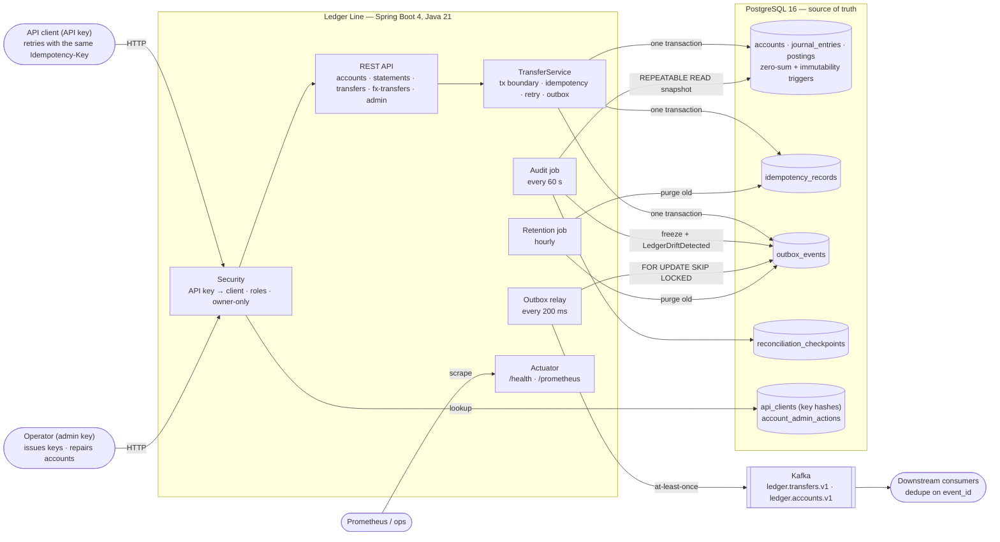
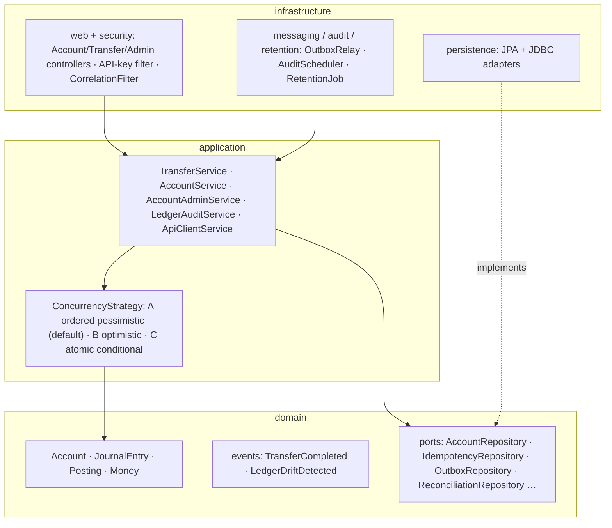
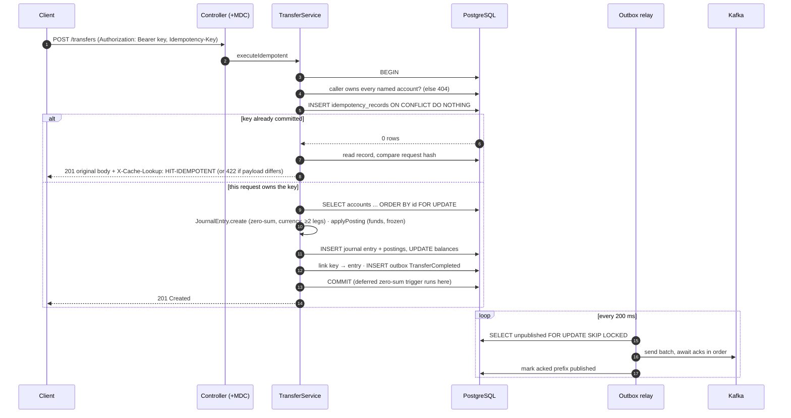
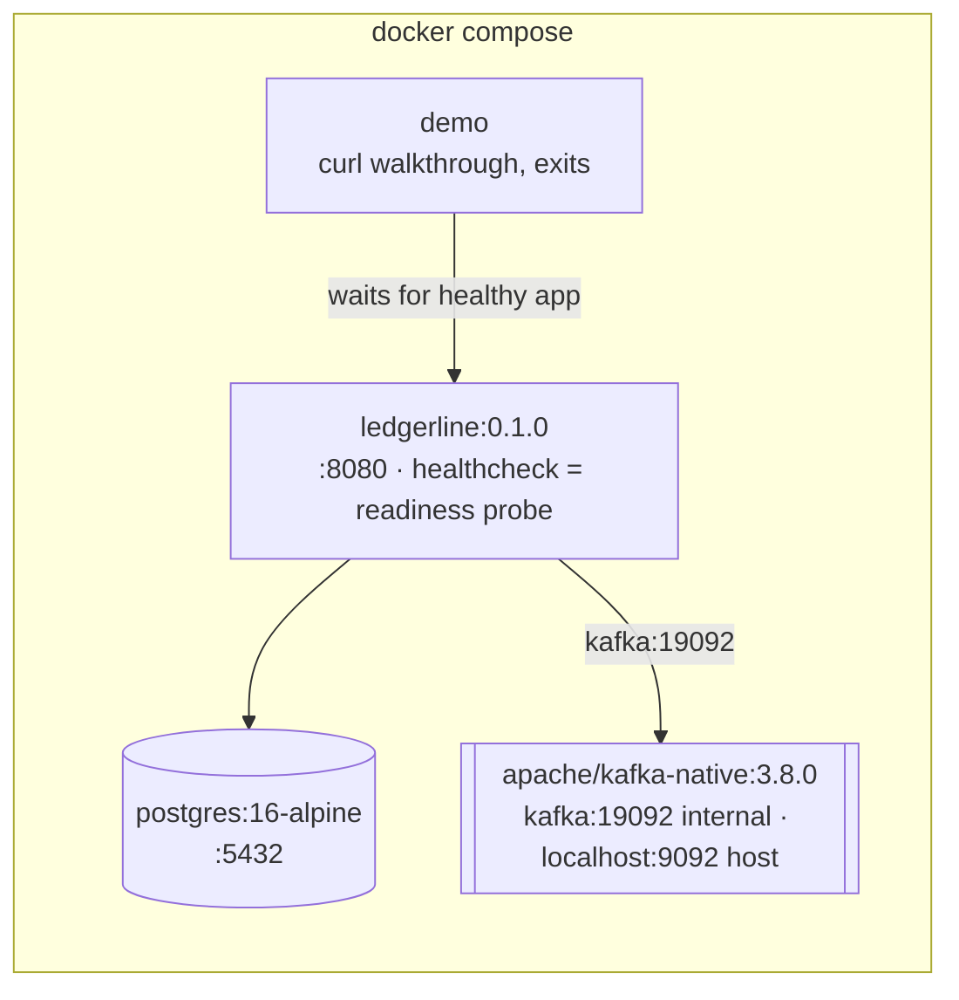

# ledgerline — Architecture

> Diagrams render on GitHub (Mermaid). Detailed step-by-step flows: [flow.md](flow.md). Why each piece exists: [decision.md](decision.md).

## 1. System context (what runs, what talks to what)

**The one rule that makes it correct:** everything that must agree is written in **one PostgreSQL transaction**: postings, balances, the idempotency record and the outbox event. Kafka is never on the transfer path.

## 2. Layers (enforced by ArchUnit on every build)

| Rule | Checked by |
|---|---|
| Infrastructure → Application → Domain, never backwards | `LayerArchitectureTest.layeringRule` |
| Domain never imports Spring (JPA mapping annotations allowed) | `domainIsFreeOfSpring` |
| Application never imports JPA, Hibernate, JDBC, Spring Data or HTTP | `applicationIsFreeOfPersistenceAndWeb` |

## 3. A transfer, end to end

## 4. Deployment (`docker compose up --build`)

The demo service prints PASS/FAIL for each guarantee and exits non-zero if any fails, so the same command is also a smoke test (it runs in CI).
